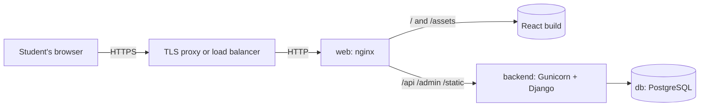

# Deploying AUB Collab

This describes how AUB Collab runs in production and how to run the same setup on your own machine.

## Architecture



| Piece | What it does | Image |
| --- | --- | --- |
| **web** | The only public service. Serves the built React app, proxies `/api`, `/admin` and `/static` to the backend, adds security headers, gzip, and long caching for hashed assets | `Frontend/Dockerfile` (Node build, then nginx) |
| **backend** | Django REST API behind Gunicorn with several worker processes. Runs migrations on start. WhiteNoise serves the admin's static files | `Backend/Dockerfile` (Python 3.13 slim, non root user) |
| **db** | PostgreSQL 16 with a named volume, so data survives restarts and redeploys | `postgres:16-alpine` |

Why this shape:

* **One origin.** The browser only talks to nginx, so API calls are same origin: no CORS setup, and cookies work simply.
* **Backend is private.** Only `web` publishes a port. The API and database are reachable only inside the Docker network.
* **Stateless app containers.** All state is in PostgreSQL, so `web` and `backend` can be rebuilt, restarted or scaled to more copies at any time.
* **Health checks everywhere.** Compose starts the backend only once the database is ready, and the web server only once the backend answers `/api/health/`. Containers that stop answering are restarted.
* **TLS at the edge.** HTTPS is handled by whatever sits in front (a university load balancer, Caddy, Cloudflare, or the hosting platform). With `DJANGO_HTTPS=True` Django trusts its `X-Forwarded-Proto` header and turns on secure cookies, HTTPS redirects and HSTS.

## Run it locally

Needs Docker Desktop (or Docker Engine with Compose v2.24+).

```bash
docker compose up --build
```

Open http://localhost:8080. The API is at http://localhost:8080/api/health/ and the admin at http://localhost:8080/admin/. Create an admin account with:

```bash
docker compose exec backend python manage.py createsuperuser
```

Stop with `Ctrl+C`, or `docker compose down`. Add `-v` to also delete the database volume.

## Deploy to a server

1. Copy `.env.production.example` to `.env.production` and set real values. Generate the secret key with `python -c "import secrets; print(secrets.token_urlsafe(50))"`. This file is git ignored; never commit it.
2. Put a TLS proxy in front of port `8080` (or set `WEB_PORT=80` if the proxy is on another machine).
3. `docker compose up --build -d`
4. To update: `git pull && docker compose up --build -d`. Migrations run automatically when the backend restarts.

## Configuration

| Variable | Where | Purpose |
| --- | --- | --- |
| `DJANGO_SECRET_KEY` | backend | Required. Long random string |
| `DJANGO_ALLOWED_HOSTS` | backend | Your domain, plus `backend` for internal calls |
| `DJANGO_CSRF_TRUSTED_ORIGINS` | backend | `https://your-domain`, needed for the admin login |
| `DJANGO_HTTPS` | backend | `True` behind a TLS proxy: secure cookies, redirect to HTTPS, HSTS |
| `DJANGO_HSTS_SECONDS` | backend | HSTS lifetime. Starts at one hour; raise it once HTTPS is confirmed working |
| `DB_ENGINE` | backend | `sqlite` (default, local development) or `postgres` |
| `DB_NAME`, `DB_USER`, `DB_PASSWORD`, `DB_HOST`, `DB_PORT` | backend, db | PostgreSQL connection |
| `DB_CONN_MAX_AGE` | backend | Seconds to reuse a database connection (default 60) |
| `GUNICORN_WORKERS` | backend | Worker processes. A good start is 2 x CPU cores + 1 |
| `WEB_PORT` | web | Port published on the host (default 8080) |

## Production checklist

* [ ] `.env.production` has a new secret key and database password
* [ ] `DJANGO_HTTPS=True` and the site is only reachable over HTTPS
* [ ] `DJANGO_ALLOWED_HOSTS` and `DJANGO_CSRF_TRUSTED_ORIGINS` list only your domain
* [ ] The PostgreSQL volume is backed up (for example a nightly `pg_dump` to off site storage)
* [ ] An admin account exists and uses a strong password

## Scaling later

* More traffic: raise `GUNICORN_WORKERS`, or run more `backend` copies (`docker compose up --scale backend=3`); nginx spreads requests across them through Docker's DNS.
* Managed database: point the `DB_*` variables at a hosted PostgreSQL and remove the `db` service.
* Shared cache and rate limit counters across copies: add a Redis service once the caching work is merged.
* Uploaded files (CVs): move from local disk to object storage such as S3 before running more than one backend copy.
